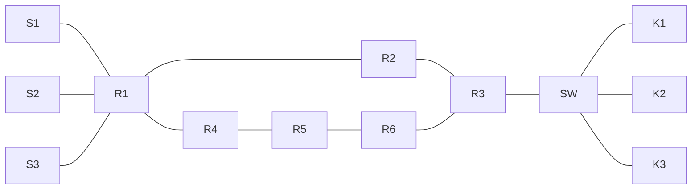

# Лабораторная работа № 3

## Вариант 22

Построить в GNS3 сеть по схеме.

### Обозначения

- **S1–S3** — конечные узлы (VPCS или виртуальные машины).
- **K1–K3** — конечные узлы (VPCS или виртуальные машины). При явном обозначении `PC (host)` используется хостовый компьютер.
- **R1–R6** — маршрутизаторы.
- **SW** — коммутатор.

### Требования к выполнению

1. Самостоятельно разработать план IP-адресации. Использовать минимум три сети с разными масками подсети.
2. На защите продемонстрировать связность конечных и промежуточных узлов.
3. Отключить одну из ветвей между R1 и R3 и продемонстрировать передачу трафика по оставшемуся пути без ручной перенастройки сети.
